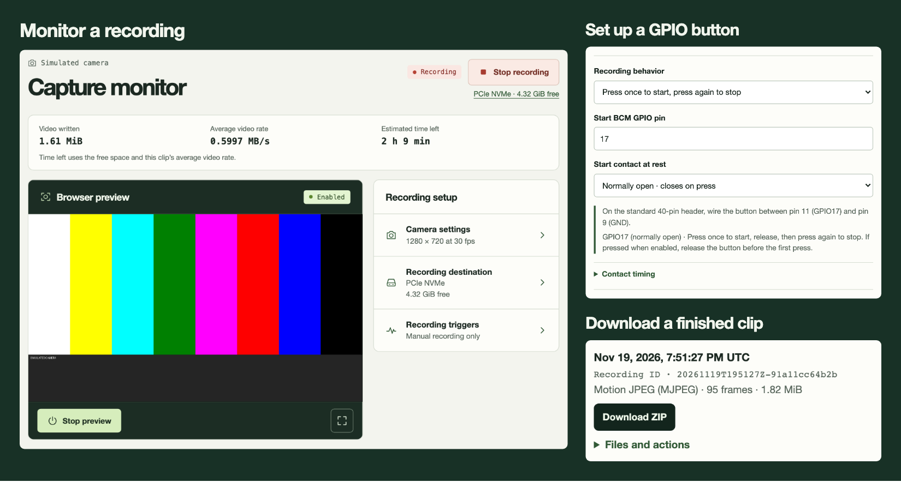

# Raspberry Pi Web Control

Control a CSI camera on a Raspberry Pi 5 or Compute Module 5 from a phone or laptop. Preview the camera, record to NVMe or USB, and download video with per-frame timestamps. Start a clip from the browser or a GPIO button, or stream live video to a computer over Ethernet or Wi-Fi.

[](docs/interface-guide.md)

[Explore the seven console pages](docs/interface-guide.md) · [Install on a Pi](#install-or-upgrade-over-ssh) · [Try the simulator](#getting-started-without-a-board)

## Install or upgrade over SSH

The console and its HTTPS API run as a systemd service on 64-bit Raspberry Pi OS. The service opens the CSI camera on demand. Stop any active recording before upgrading. From the checkout on your workstation, run the installer with your Pi's SSH login and address.

```sh
./install.sh ubuntu@192.168.55.100
```

The installer builds the checkout's release if its archive is missing from `dist/`, then installs the newest local arm64 package by Debian version. Enter your SSH or sudo password when prompted. Once the service is running, open `https://192.168.55.100:8080` using the board's actual address or hostname and verify its certificate. An intentionally stopped service stays stopped on upgrade. [Package and access guide](docs/package.md)

To collect a board report independently, run `./install.sh --diagnose ubuntu@192.168.55.100`. Each run prints its private local report directory under `dist/install-reports/`.

## Getting started without a board

Use Python 3.11 or newer. From the checkout, run:

```sh
python3 -m venv .venv
. .venv/bin/activate
python -m pip install -r requirements-dev.txt
python -m rpi_web_control --simulate
```

Open [the local console](http://127.0.0.1:8080). The console opens directly. To require sign-in, start the simulator with `RPI_CONTROL_REQUIRE_TOKEN=1` and read the generated token with `cat .dev-state/token`. Enable preview, choose a sensor mode, or start a recording. The simulator generates a test pattern and writes real video, frame indices and session metadata under `.dev-state/recordings/`. The firmware editor uses a fixture under the development state directory and simulates reboot. Timers also work locally. Network changes in the simulator use virtual Ethernet and Wi-Fi interfaces. GPIO, serial and sysfs sensors use their respective OS adapters when available.

From the same checkout, `make check` runs the tests, `make deb` creates the arm64 installer under `dist/`, and `make verify-deb` checks the archive. The test suite uses OpenSSL. With FFmpeg installed, it independently decodes the videos with ffprobe. Device deployment, certificate verification, storage provisioning and upgrades are covered in the [package guide](docs/package.md).

## Operating the camera

On **Capture monitor**, **Recording setup** shows the selected video mode, destination and trigger rules. Select a row to change it. **Start preview** lets you frame the shot. **Start recording** in the page header starts saving video to the selected drive. During recording, the monitor shows the video size, average rate and estimated time left.

Use **Stop recording** for a manual clip, or **Stop & pause triggers** when a rule holds the recording. Choose **View recording** to open that clip by its ID and download it. Return held inputs to rest before choosing **Resume triggers**. On a phone, open **Menu** to switch between capture tasks and configuration.

The console compares the Pi's clock with the clock on the device running the browser. If the clocks differ by more than five seconds after allowing for request latency, a warning appears on any page. Check your computer or phone's time and stop any active recording. Selecting **Set Pi time** immediately copies the browser device's time to the Pi. This works over a local connection with no internet access.

| Console page | Controls |
| --- | --- |
| Capture monitor | Watch the browser preview, check measured capture FPS and see which sources are holding the current recording. |
| Recordings | Find a completed session by ID, date or format, download a ZIP with video and timestamps or choose an individual file. Delete a session or clean completed recordings on a managed external drive. |
| Network stream | Choose a receiver IP, UDP port and optional stream FPS limit. Copy the GStreamer playback command and compare capture rate, sender rate and drop counters. |
| Camera settings | Run a capture test for one or all advertised sensor modes, compare measured FPS, and set output size, bit depth, FPS and OSD. Choose or restore a sensor boot profile and request a reboot. [Supported modules and vendor profiles](docs/firmware.md#built-in-camera-profiles) |
| Recording drives | See the active recording directory and choose **Use USB** or **Use NVMe** for a ready drive. Expand disk setup to mount or prepare a drive. |
| Recording triggers | Set up a GPIO button to record while held or to start and stop on successive presses. A second GPIO or serial command can also stop a clip. Timer, numeric sensor and UART rules are available. [GPIO17 pushbutton setup and wiring](docs/triggers.md#set-up-a-momentary-button-on-gpio17) |
| Network settings | Scan nearby Wi-Fi networks and connect the Pi to a router while keeping a fixed Ethernet address. The Pi can also host or bridge an access point. Direct-cable recovery uses `192.168.55.100` by default. [Join Wi-Fi](docs/network.md#join-an-existing-wi-fi-network) · [Host an access point](docs/network.md#create-a-wi-fi-access-point) |

The frame rate setting applies to capture. Browser preview shares the latest JPEG among subscribers, at up to eight updates per second. Closing the preview or losing a browser connection leaves an active recording running. The last manual or trigger release closes the clip. A capture failure ends the affected session. While a previously active source still requests recording, the service attempts to reopen a new session with backoff. Changing camera settings or storage during an active recording returns a conflict.

| Requested rate | Recording | Preview | Timestamp OSD |
| --- | --- | --- | --- |
| Up to 60 fps | Motion JPEG in `video.mjpeg` | Color | Optional, recorded in the pixels |
| Above 60 fps, including 240 | Planar 8-bit YUV420 in `video.y4m` | Reduced-size grayscale | Bypassed |

When planning a high-speed recording, open **Camera settings → Video settings** and edit the output dimensions and target FPS. Above 60 fps, **Estimated write rate** and **Space per minute** update before you save. At 640 × 480 and 240 fps, video alone needs about 111 MB/s or 6.64 GB per minute. Allow extra space for the frame index and headers. At 60 fps and below, JPEG size varies with the scene. Record a sample on the chosen drive to measure its space use. For sustained high-speed recording, test long enough for the drive’s write cache to fill. [Hardware acceptance procedure](docs/hardware-validation.md#capture-and-playback)

Selecting a detected mode sets its sensor bit depth, dimensions and maximum frame rate. For 720p240 on the IMX577, select the 1280 × 720 entry at the desired depth, set the rate to 240 and save. In the API, `camera.sensor_bit_depth` accepts a reported depth or `0` for automatic selection. The active mode appears in camera status and the recording manifest. The depth describes the sensor readout. High-speed YUV420 files use eight bits per component for either sensor depth.

To measure what the attached sensor delivers, stop preview, streaming and recording, then open **Camera settings → Sensor tests**. Select a single mode or **All detected modes** and choose **Run sensor test**. Compare the requested and measured FPS for each resolution and bit depth. [Camera test procedure](docs/hardware-validation.md#measure-every-advertised-sensor-mode)

## Receive live video on a PC

1. Connect the receiving PC and Pi over Ethernet or Wi-Fi. Open `https://<device-hostname>.local:8080` on the PC or another device such as a phone. Verify the certificate and, if prompted, sign in with the device token. See the [access and credential instructions](docs/package.md).
2. In **Camera settings → Video settings**, choose the resolution and FPS. In **Network stream → Play video on**, choose **This device** to send video to the computer running the browser. If you control the Pi from a phone, choose **Another computer** and enter the receiver’s IP. Open **Port and frame rate** to change the default UDP port (`5004`) or limit the stream FPS while recording at the full camera rate.
3. Choose **Copy receiver command** and run it in a terminal on the receiving PC. Select **Start live stream** in the console. The video opens in a player window on that PC when frames arrive. Closing the browser leaves the sender running. Use **Stop live stream** when finished.

The high-speed stream and recording can run together. The live sender uses individually coded JPEG frames, a bounded queue and nonblocking datagrams. End-to-end latency includes exposure, transport, decoding and display. A zero-buffer receiver setting cannot reduce all of these times to zero. On an unreliable link, unreceived UDP packets can cost a full frame. See the [receiver setup and latency measurement guide](docs/live.md).

## Matching a frame to a system event

Keep the video, `frames.csv` and `session.json` together. Each CSV row identifies the frame that was written, including its zero-based index, byte offset, byte count and sensor timestamp in nanoseconds. The manifest identifies the camera backend, capture settings, boot ID, video format and completion status. A clean stop flushes the video and index and marks the session complete. A power interruption can leave a partial clip marked as recording, with a truncated or unindexed tail.

On a Pi, `sensor_ns` comes from libcamera's `SensorTimestamp` for the first exposed row. Each row also contains estimates in the system's monotonic and realtime clocks, plus the width of the clock sampling window. These estimates are suitable for correlating events from the same system. Exposure across rows, scheduling delays and wall-clock adjustments affect interpretation. [libcamera sensor timestamp definition](https://github.com/raspberrypi/libcamera/blob/main/src/libcamera/control_ids_core.yaml)

Export journal entries with `journalctl -b -u rpi-web-control.service -o json`. Match `_BOOT_ID` to the manifest (ignore hyphens), multiply `__MONOTONIC_TIMESTAMP` by 1,000 to convert microseconds to nanoseconds, and find the nearest `monotonic_ns` in the frame index. For UTC event logs use `realtime_ns`. Use the index for capture timing during analysis, including gaps between frames. [systemd journal fields](https://www.freedesktop.org/software/systemd/man/latest/systemd.journal-fields.html)

```sh
python3 skills/rpi-capture-development/scripts/check_recording.py /path/to/session --fps 240
```

## Convert a downloaded recording to MP4

On **Recordings**, select **Download ZIP** for the session. The ZIP contains the original video, frame timestamps and manifest. On the computer running the converter, install FFmpeg with ffprobe and activate your Python 3.11+ environment. Install Pillow once in that environment, then pass the downloaded ZIP to the converter.

```sh
python3 -m pip install Pillow
python3 tools/render_recording.py "$HOME/Downloads/20261119T120000Z-012345abcdef.zip" capture.mp4
```

The ZIP defaults to sensor-timed playback, preserving capture gaps. The converter is also downloadable under **Recordings → Convert to MP4**. A completed session directory defaults to the configured constant capture rate. For example, the following adds temperatures from a CSV containing `monotonic_ns,temperature_c` to a constant-rate MP4.

```sh
python3 tools/render_recording.py ./session capture-osd.mp4 \
  --telemetry telemetry.csv --clock monotonic_ns --field temperature_c=Temp \
  --max-age-ms 100 --gap-policy reject
```

The exporter retains one output frame per saved frame. See the [desktop guide](docs/post-processing.md) for installation on a Mac, playback timing options and time-aligned telemetry.

## Service interfaces

The API accepts requests without a token by default. When token protection is enabled, the browser signs in through `POST /api/login` with a JSON object containing the device token. API clients can also send the token in an `Authorization: Bearer` header over HTTPS. Mutations take JSON objects and return a JSON result or an `error` string.

| Method and path | Purpose |
| --- | --- |
| GET /api/status | Camera state, configuration, per-rule status, recording owners, disk availability, radio capabilities and `device_realtime_ms` (Pi system realtime clock, integer Unix epoch milliseconds). During recording, `camera.recording_video_bytes` counts bytes in the current video file and `camera.recording_video_bytes_per_second` reports its average growth rate when available. |
| POST /api/clock | Send a JSON object with `browser_realtime_ms` set to the browser's current `Date.now()` value (integer Unix epoch milliseconds) and `confirm` set to `true`. The service accepts times from 2000-01-01 UTC up to the start of 2100 UTC, exclusive. A recording, held recording claim or scheduled reboot returns HTTP 409. |
| GET /api/capabilities | Detected camera, sensor properties and available modes |
| POST /api/camera/mode-test | Start a capture test with `{"action":"start"}`. Add `"mode":{"width":1280,"height":720,"bit_depth":8}` to select one advertised sensor mode. Poll `camera.mode_test` in `GET /api/status` for progress and results. Stop testing with `{"action":"cancel"}`. |
| GET /api/storage | Attached media, filesystems, capacity and usable recording roots |
| GET or POST /api/nvme, /api/usb | Inspect PCIe NVMe or USB drives and their current revisions. Mount an eligible ext4 volume or confirm erasure and prepare a dedicated recording disk. |
| GET /api/recordings | List completed sessions from the active destination (`source=current`, the default), the first configured recording root (`source=default`), managed NVMe (`source=nvme`) or managed USB (`source=usb`). Follow the returned cursor and target ID for more results. To look up a single recording in that folder, pass its full ID as `session` and omit the cursor. |
| GET or HEAD /api/recordings/{session}/archive.zip | Follow the listing's `archive.url` to download the complete session as `{session}.zip`. An interrupted download restarts at the beginning. |
| GET or HEAD /api/recordings/{session}/{filename} | Use the file URL from the session listing to download original video, frame timestamps or the manifest. Supports single byte ranges. |
| POST /api/recordings/cleanup | Use `action=plan` with the listing's source and target ID. Supply a session for one recording or omit it for all eligible sessions directly in the directory. `action=delete` requires the matching revision and typed confirmation from the review. |
| GET /api/tools/render_recording.py | Download the standalone workstation converter. |
| GET /api/firmware | Boot configuration text, revision, installed profiles, conflicts, backup and pending reboot state |
| POST /api/live | Start RTP/JPEG with `{"enabled":true,"host":"192.168.55.10","port":5004,"max_fps":60}`. Omit `host` to use the HTTPS peer address, or enter the receiver’s numeric unicast IPv4 or IPv6 address. The optional integer `max_fps` (1–1000) limits the stream. Omit it for the camera rate. Stop with `{"enabled":false}`. |
| POST /api/firmware | Stage a profile or restore its backup using the reviewed configuration revision and CSI port |
| POST /api/reboot | Request a reboot using the reviewed firmware revision and an explicit boolean confirmation |
| GET /api/stream.mjpg | Multipart JPEG stream while preview is enabled |
| POST /api/preview, POST /api/recording | Set `{"enabled":true}` or `{"enabled":false}` |
| POST /api/triggers/pause | Send `{"paused":true}` to release automatic recording requests while keeping any manual hold, or `{"paused":true,"stop_manual":true}` to release both. Send `{"paused":false}` to resume the saved rules. Read `triggers_paused` in `GET /api/status`. |
| POST /api/config | Save one or more sections. Camera fields merge, storage takes `{"directory":"/absolute/path"}`, and triggers take the complete rule list. |
| POST /api/network | Enable Wi-Fi, scan nearby networks on a selected radio, stage a connection and confirm it or roll it back. [Network API](docs/network.md#api) |
| POST /api/logout | End the browser session using an empty JSON object |

## Extending the project

Start with [AGENTS.md](AGENTS.md) and its two versioned project skills. The camera worker owns device buffers and recording boundaries. Input adapters publish recording claims, the application coordinates those claims, and the web layer exposes the same operations to the dashboard and API clients. Hardware imports are lazy, and the browser assets run directly from the package without a build step or external services.

- [Recording triggers, GPIO pinout, contact wiring and serial command examples](docs/triggers.md)
- [Ethernet, Wi-Fi, bridged access points and rollback](docs/network.md)
- [Sensor profiles, boot configuration and recovery](docs/firmware.md)
- [NVMe, USB, microSD and SPI flash recording destinations](docs/storage.md)
- [Pi 5 and CM5 validation worksheet](docs/hardware-validation.md)
