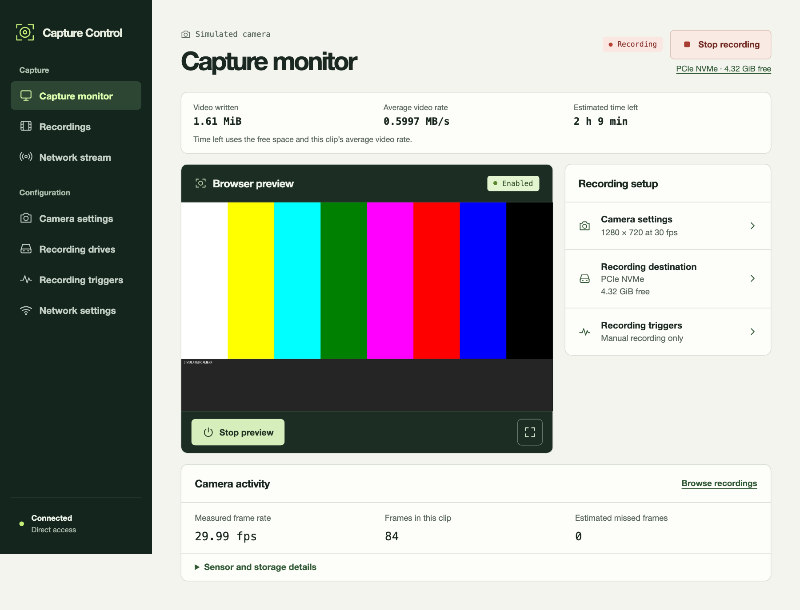
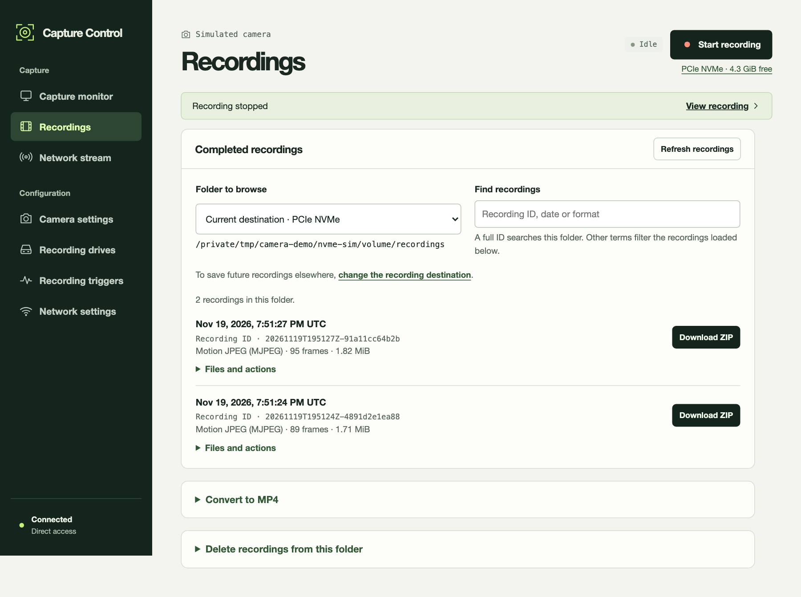
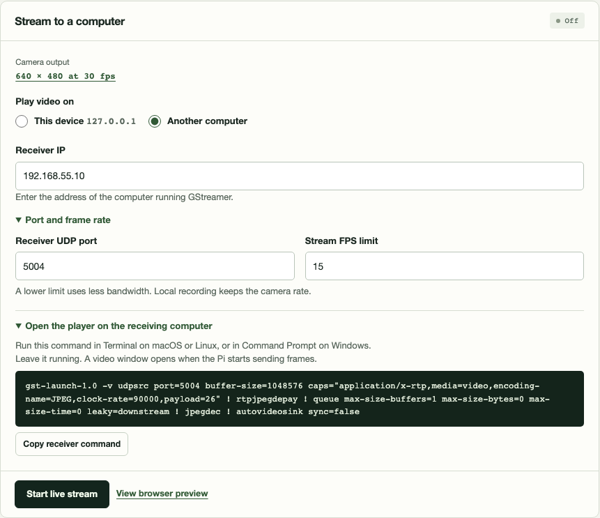
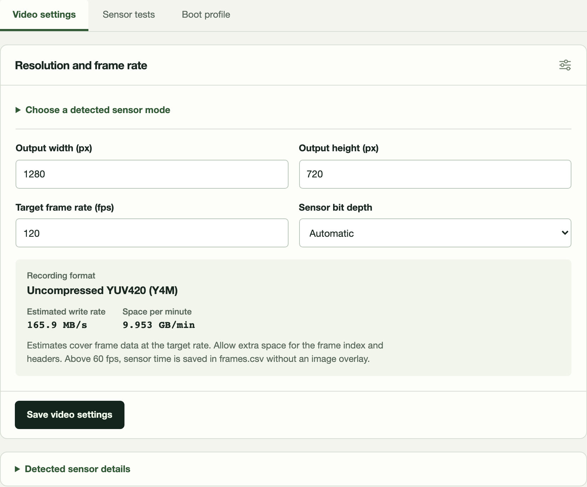
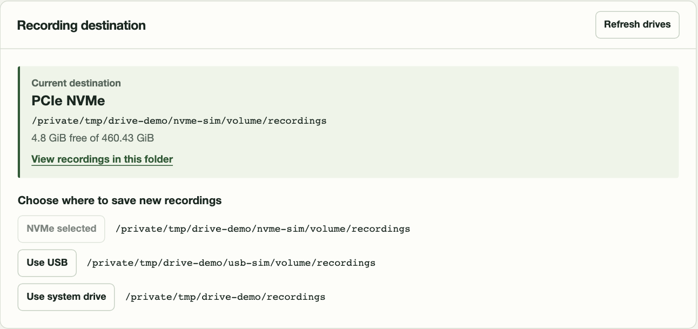
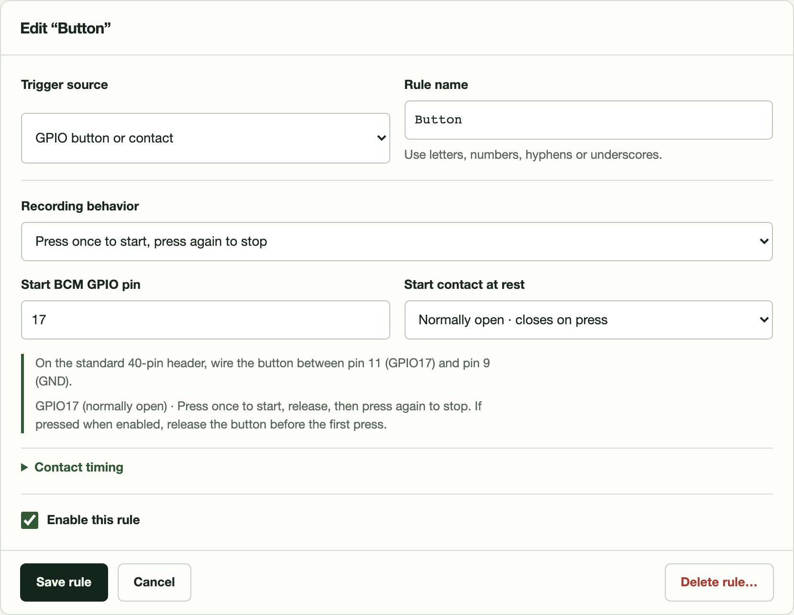
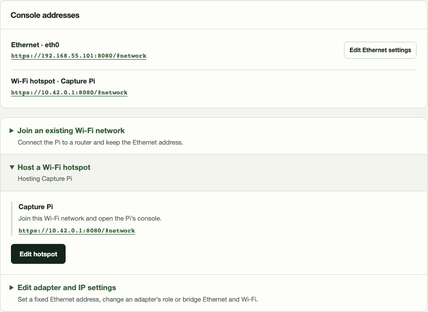

# A visual guide to the camera console

For a first clip, open **Capture monitor**, check the camera mode and recording destination, then choose **Start recording**. After **Stop recording**, choose **View recording** to open that clip. The screenshots below come from the built-in simulator. The color bars, file paths, network addresses and rates are examples. Select an image to open it at full size.

| Capture | Configuration |
| --- | --- |
| [Preview and record](#preview-and-record) | [Choose a camera mode](#choose-a-camera-mode) |
| [Find and download a clip](#find-and-download-a-clip) | [Choose where to save](#choose-where-to-save) |
| [Stream to a computer](#stream-to-a-computer) | [Record with a button](#record-with-a-button) |
| | [Connect over Ethernet or Wi-Fi](#connect-over-ethernet-or-wi-fi) |

## Preview and record

**Capture monitor** brings the live view, recording controls and destination together. **Start preview** lets you frame the shot. **Start recording** saves a clip even with the preview off. While recording, check **Video written**, **Average video rate** and **Estimated time left** above the preview.

## Find and download a clip

In **Recordings**, choose the folder containing your clip. Paste its full recording ID into **Find recordings** if the Pi clock was wrong. Choose **Download ZIP** to get the video, frame timestamps and session metadata together. [Convert the ZIP to MP4](post-processing.md)

## Stream to a computer

In **Network stream**, choose **This device** if the browser is on the receiving computer. If you operate the Pi from a phone, choose **Another computer** and enter that computer’s **Receiver IP**. Run the copied GStreamer command there, then choose **Start live stream** on the Pi’s console. [Set up the receiver](live.md#connect-and-start-playback)

## Choose a camera mode

Open **Camera settings → Video settings** to set resolution and frame rate. Above 60 fps the console estimates the write rate and space per minute for uncompressed video. In this example, 1280 × 720 at 120 fps needs about 166 MB/s of frame data. **Sensor tests** measures the camera’s frame rate, and **Boot profile** selects the sensor configuration for the next boot. [Test sensor modes](hardware-validation.md#measure-every-advertised-sensor-mode) · [Choose a boot profile](firmware.md#switch-a-profile)

## Choose where to save

Open **Recording drives** before starting a clip. Select **Use NVMe** or **Use USB** on a ready drive, then check **Current destination**. In the example, NVMe is selected and USB is also available. **View recordings in this folder** opens the files already there. [Mount or prepare a recording drive](storage.md#record-to-usb-or-pcie-nvme)

## Record with a button

In **Recording triggers**, choose **Add rule** and select **GPIO button or contact**. For a normally open button between GPIO17 and ground, choose **Press once to start, press again to stop**, set the start pin to **17**, and enable and save the rule. A different behavior lets you record only while the button is held. [GPIO17 wiring diagram and rule examples](triggers.md#set-up-a-momentary-button-on-gpio17)

## Connect over Ethernet or Wi-Fi

**Network settings → Console addresses** lists the URL to open for each active connection. Choose **Join an existing Wi-Fi network** to connect the Pi to a router, or **Host a Wi-Fi hotspot** to connect your phone directly to the Pi. The example shows Ethernet and a Pi-hosted hotspot active together. [Configure Ethernet, Wi-Fi and wired recovery](network.md)

