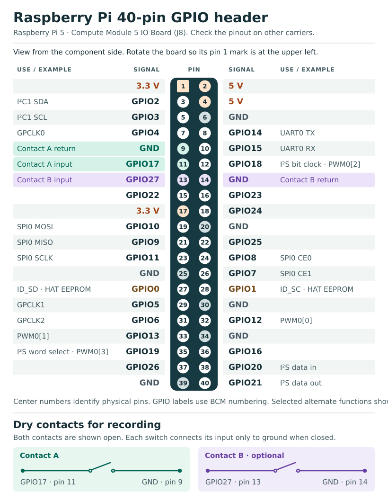

# Recording triggers

A GPIO button can record while held or start and stop recording on successive presses. A second contact or a serial command can also stop a recording. Several rules and the manual recording control can share one clip. The clip closes when the last source releases it. Applying unrelated settings preserves existing claims and timer schedules. Removing, disabling, or editing an active rule releases its claim before its replacement starts.

Choose **Recording triggers → Add rule** and select a **Trigger source**. **Save rule** returns to the list, where each entry shows its current state and the events that start and stop recording. To change a saved rule, choose **Edit** beside its name. **Cancel** discards your edits and **Delete rule…** removes the saved rule after confirmation.

Each rule has a unique `id` of 1–48 ASCII letters, digits, hyphens or underscores, a `type`, and an optional boolean `enabled` (default `true`). Up to 32 rules are supported. Unknown fields, invalid types and duplicate enabled GPIO or UART inputs are rejected before the active configuration changes.

| Type | Required fields | Optional fields and defaults |
| --- | --- | --- |
| `timer` | None | `interval_s: 60`, `duration_s: 5` |
| `gpio` | `pin` | `contact: "NO"`, `debounce_ms: 30`. Choose `toggle_on_press: true` or a separate `stop` input. A separate input can use `stop_on_return`. |
| `sensor` | `path`, `threshold` | `comparison: "above"`, `hysteresis: 0`, `poll_ms: 250` |
| `uart` | None | `device: "/dev/serial0"`, `baud: 115200`, `start_command: "START"`, `stop_command: "STOP"` |

## Timer

`{"id":"sample","type":"timer","interval_s":60,"duration_s":5}`

The first window opens one interval after enabling the rule. This example records for five seconds every minute. Schedules use the monotonic clock, skip elapsed windows, and restart when the service or rule restarts. Both values accept fractional seconds from 0.1 to 31,536,000. The duration must be shorter than the interval.

## GPIO

### Set up a momentary button on GPIO17

For a pushbutton whose contacts close only while pressed, use a normally open (**NO**) contact. With power off, connect one side to **physical pin 11 (GPIO17)** and the other to **pin 9 (GND)**. For a switch with terminals marked COM, NO and NC, use **COM and NO**. The input uses the Pi's internal pull-up. [Header diagram](#40-pin-header-and-contact-wiring)

1. In **Recording triggers**, edit the existing GPIO17 rule or choose **Add rule** if GPIO17 is free. Enter a **Rule name** such as `button` and choose **GPIO button or contact**.
2. Set **Start BCM GPIO pin** to `17`, the contact to **Normally open** and **Contact timing → Start debounce time (ms)** to `30`.
3. Choose the recording behavior in the table. Enable and save the rule. Wait for **Ready**, then test it with manual recording off. [See the GPIO17 rule in the console](interface-guide.md#record-with-a-button)

| Desired operation | Recording behavior | Test |
| --- | --- | --- |
| A short press starts a clip and a second press stops it | Press once to start, press again to stop | Press, release, confirm recording continues, then press again. |
| Recording lasts only as long as the button is held | Hold to record | Press and hold to start, then release to stop. |

The two-press option is available from `0.9.1-1`. Its API rule is `{"id":"button","type":"gpio","pin":17,"contact":"NO","debounce_ms":30,"toggle_on_press":true}`. A button held while this rule is enabled or the Pi starts must be released before the first press counts. Existing rules keep their configured behavior on upgrade.

### 40-pin header and contact wiring



Use the physical pin numbers to wire the connector and the BCM numbers in **Recording triggers**. For example, entering `17` selects GPIO17 on physical pin **11**. Physical pin **17** supplies 3.3 V. Locate the pin 1 mark on the board before counting. This pinout applies to the Raspberry Pi 5 header and J8 on the official CM5 IO Board. Check the connector drawing for your own CM5 carrier. [Raspberry Pi header pinout](https://www.raspberrypi.com/documentation/computers/raspberry-pi.html#gpio-and-the-40-pin-header) · [CM5 IO Board datasheet, figure 5](https://pip-assets.raspberrypi.com/categories/1097-raspberry-pi-compute-module-5-io-board/documents/RP-008182-DS-3-cm5io-datasheet.pdf)

With the Pi powered off, wire a **voltage-free contact** between the chosen GPIO and GND. For the normally closed examples below, use **COM and NC** on a relay. Leave the 3.3 V and 5 V supply pins out of the contact circuit. Opening the contact reads high and closing it to ground reads low. [GPIO input levels and pull-ups](https://www.raspberrypi.com/documentation/computers/raspberry-pi.html#inputs)

| Contact | Physical wiring | Value in the web form |
| --- | --- | --- |
| Start, or start/stop on one contact | Pin **11** → contact A → pin **9** (GND) | `17` |
| Optional separate stop | Pin **13** → contact B → pin **14** (GND) | `27` |

### Record while one contact is open

1. Wire contact A and close it. In **Recording triggers → Add rule**, enter `door` for **Rule name** and choose **GPIO button or contact**.
2. Set **Start BCM GPIO pin** to `17`, the contact to **Normally closed** and **Contact timing → Start debounce time (ms)** to `30`. Select **Hold to record**, check **Enable this rule** and choose **Save rule**.
3. Open A and check that the rule shows **Holding recording**. Close A and it returns to **Ready**. With manual recording off and no other active rules, the completed clip appears in **Recordings**.

```json
{"id":"door","type":"gpio","pin":17,"contact":"NC","debounce_ms":30}
```

This mode evaluates the initial contact position. If A is already open when the service starts or the rule is enabled, recording starts after debounce. A broken wire on an NC circuit also appears open.

| Contact type | Contact at rest | Condition that activates the input |
| --- | --- | --- |
| Normally open (`NO`) | Open, input high | Close the contact to GND |
| Normally closed (`NC`) | Closed, input low | Open the contact |

### Start on one contact and stop on another

The separate GPIO and UART stop options are available from version `0.9.0-1`. [Package installation](package.md)

Wire A and B as shown above. Start with both closed. Edit the same GPIO rule, keeping the start input on GPIO17. Choose **Stop with a second contact**, set **Stop BCM GPIO pin** to `27`, **Stop contact at rest** to **Normally closed** and **Contact timing → Stop debounce time (ms)** to `30`. Choose **Save rule** and wait for **Ready**.

| Action | Expected result when this rule is the only recording source |
| --- | --- |
| Open A | Recording starts. |
| Close A | Recording continues. |
| Open B | Recording stops. Keeping B open inhibits another start. |
| Close B, then open A again from its closed position | A new clip starts. |

```json
{
  "id": "door", "type": "gpio", "pin": 17, "contact": "NC", "debounce_ms": 30,
  "stop": {"type": "gpio", "pin": 27, "contact": "NC", "debounce_ms": 30}
}
```

### Start on a contact and stop with a serial command

Use contact A alone. Edit the rule and choose **Stop with a serial command**. Set **Stop serial port** to the receiver on the Pi (for example `/dev/ttyUSB0`), **Stop baud rate** to `115200` and **Stop command** to `STOP`. Save the rule and wait for **Ready**.

Open A to start. On the **sending device**, use a serial terminal at **115200, 8N1**, type `STOP` and send LF or CRLF. The bytes for `STOP` followed by LF are `53 54 4F 50 0A` in hex. The command is case-sensitive. It releases this rule even while A is still open. Close and reopen A for the next clip. [UART port and command settings](#uart)

```json
{
  "id": "door", "type": "gpio", "pin": 17, "contact": "NC", "debounce_ms": 30,
  "stop": {"type": "uart", "device": "/dev/ttyUSB0", "baud": 115200, "command": "STOP"}
}
```

With a separate stop input, the service waits for a fresh start transition after both inputs are ready. If A was already open at startup or after an input failure, close and reopen it. A stop from B or UART releases only that rule’s claim.

### Stop on the first of two events

When using a second GPIO or a UART stop command, check **Also stop when the start contact returns to normal** to keep contact A as a stop as well. With the two NC contacts above, opening A starts the clip. **Closing A** or **opening B** ends this rule’s recording request, whichever happens first. With a UART stop, either **closing A** or **receiving the stop line** ends the request. If the external event stops the recording while A is open, close and reopen A for the next clip.

In the JSON configuration, set `"stop_on_return": true` alongside the `stop` object. Leaving the checkbox clear keeps recording after A closes and waits for the configured external stop.

### Input timing and troubleshooting

Choose an available BCM line from 0–27 routed to the header on your board. A contact must remain stable for its debounce time (0–1000 ms). Zero disables the filter. The service discovers the RP1 controller by its kernel label `pinctrl-rp1` and needs access to the GPIO chip. If a rule shows **Input error**, inspect the message beside its name and check whether the selected line or serial port is already in use. Capture starts on demand. Allow for debounce and camera startup latency. Short pulses can be lost if the kernel event buffer overflows.

**Recording starts as soon as the rule is enabled.** Check the button at rest. Using an NO pushbutton with an NC hold rule makes the open, released button the active input. Edit that rule, choose NO, then save and test a press and release.

**The button stops its rule but the clip continues.** Check the sources listed beside the recording controls at the top of the page. Open **Recording triggers** to see which rules show **Holding recording**. To end the clip immediately while a trigger holds it, choose **Stop & pause triggers**. This releases the recording requests and pauses all automatic rules. For a manual-only clip, use **Stop recording**.

To pause only the automatic rules while keeping a manual recording running, choose **Recording triggers → Pause all triggers**. To resume automatic operation, first return the inputs to their resting state and choose **Resume triggers**. The service also resumes saved rules when it restarts. An active hold input can immediately start a new clip. To turn off just one rule across restarts, choose **Disable rule** on a row marked **Holding recording**, or edit the rule, clear **Enable this rule** and choose **Save rule**. The edit path also works on older versions. Release any remaining manual hold to close the clip.

**The console reports `[Errno 5] Input/output error` with a session name.** Write down the session name. Open **Recording drives**, choose **Refresh drives** and check the selected drive and directory before starting another clip. [Troubleshoot a recording I/O error](storage.md#troubleshoot-a-recording-io-error)

## Numeric sensor

`{"id":"temperature","type":"sensor","path":"/sys/class/thermal/thermal_zone0/temp","threshold":60000,"hysteresis":2000,"comparison":"above","poll_ms":250}`

Use a readable sysfs attribute containing one finite number in its native units. The thermal example starts at 60 °C and releases below 58 °C on drivers reporting millidegrees. An `above` rule activates at or above the threshold. A `below` rule activates at or below it and releases above the threshold plus hysteresis. The sampling interval is 20–60000 ms. Supported attribute trees are thermal and hwmon under `/sys/class`, plus IIO, 1-Wire and I2C devices under `/sys/bus`.

## UART

`{"id":"controller","type":"uart","device":"/dev/ttyAMA0","baud":115200,"start_command":"REC ON","stop_command":"REC OFF"}`

Choose the UART exposed by the carrier and configured in the OS. Serial aliases such as `/dev/serial0`, supported `ttyAMA`, `ttyS`, `ttyUSB`, `ttyACM` ports and `/dev/serial/by-id/...` are accepted. The service requests exclusive access, 8 data bits, no parity and 1 stop bit. Each message ends in LF or CRLF. Commands match exactly, including case and spaces. A start line holds the claim until a stop line, device failure or rule shutdown. Other lines are ignored. Command length is 1–64 printable ASCII characters. Use one rule per physical port, including its aliases.

## Runtime status

Each configured rule reports its ID, type, enabled setting, `active` claim, `state`, and last `error`. The state is `disabled`, `paused`, `starting`, `ready`, or `error`. On an input failure the worker releases its claim and retries after two seconds. A reconnected UART rule needs a fresh start line. Toggle and separate-stop GPIO rules need a fresh start transition. Hold and sensor rules evaluate the current level again. Other workers continue independently.

To add an input, extend validation in `rpi_web_control/triggers.py`, register an adapter in `rpi_web_control/trigger_inputs.py`, and update the rule editor and its tests. Adapters own their device for the lifetime of one worker, call `ready()` once operational, call `publish(bool)` on level changes and check the stop event between bounded I/O waits.

## References

- [RP1 datasheet, GPIO alternate functions](https://datasheets.raspberrypi.com/rp1/rp1-peripherals.pdf)
- [Raspberry Pi GPIO usage and chip discovery](https://pip.raspberrypi.com/categories/685-app-notes-guides-whitepapers/documents/RP-006553-WP/A-history-of-GPIO-usage-on-Raspberry-Pi-devices-and-current-best-practices.pdf)
- [libgpiod line requests](https://libgpiod.readthedocs.io/en/v2.3.2/python_line_request.html)
- [pySerial API](https://pyserial.readthedocs.io/en/stable/pyserial_api.html)
